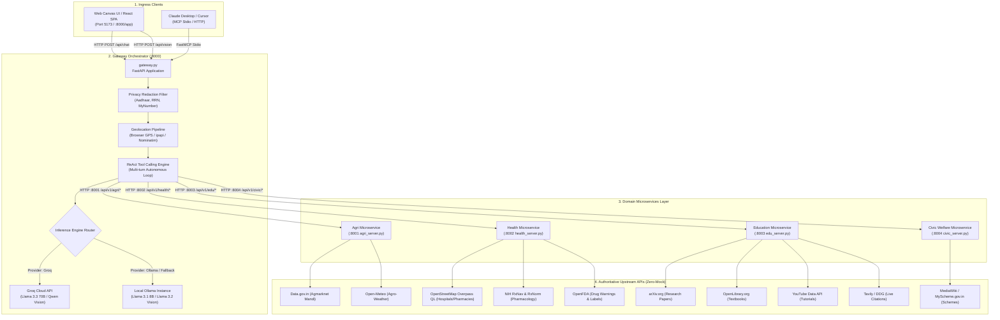
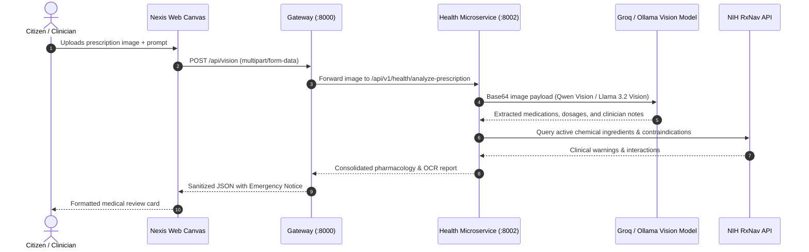
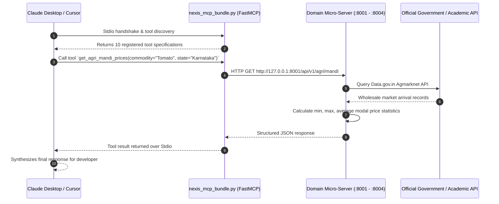

# ⚡ Nexis AI — Unified Multi-Agent Intelligence Runtime

> **Production-grade distributed multi-agent intelligence runtime for Public Utility, Agriculture, Healthcare, Education, and Civic Governance.**

[](LICENSE)
[](https://www.python.org/)
[](https://fastapi.tiangolo.com)
[](https://github.com/jlowin/fastmcp)
[](https://groq.com)
[](https://ollama.ai)

---

## 📑 Table of Contents

1. [Project Overview](#-project-overview)
2. [Core Principles](#-core-principles)
3. [System Architecture](#-system-architecture)
4. [Tech Stack & Tools Used](#-tech-stack--tools-used)
5. [End-to-End System Workflows](#-end-to-end-system-workflows)
   - [Workflow 1: Citizen Query & Agentic ReAct Loop](#1-citizen-query--agentic-react-loop)
   - [Workflow 2: Multimodal Prescription & Document Vision Analysis](#2-multimodal-prescription--document-vision-analysis)
   - [Workflow 3: Model Context Protocol (MCP) Execution](#3-model-context-protocol-mcp-execution)
   - [Workflow 4: Reverse Geocoding & Context Grounding](#4-reverse-geocoding--context-grounding)
   - [Workflow 5: Distributed Cluster Health Monitoring](#5-distributed-cluster-health-monitoring)
6. [Domain Microservices Breakdown](#-domain-microservices-breakdown)
7. [Model Context Protocol (MCP) Tool Registry](#-model-context-protocol-mcp-tool-registry)
8. [Privacy & Regulatory Guardrails](#-privacy--regulatory-guardrails)
9. [Repository Directory Structure](#-repository-directory-structure)
10. [Getting Started & Installation](#-getting-started--installation)
11. [Configuration Reference (.env)](#-configuration-reference-env)
12. [Running & Verifying Tests](#-running--verifying-tests)
13. [License](#-license)

---

## 🌐 Project Overview

**Nexis AI** is an autonomous, distributed multi-agent intelligence platform purpose-built for high-stakes public domain intelligence: **Agriculture**, **Healthcare**, **Education**, and **Civic Governance**. 

Unlike conventional chatbots that rely on static datasets or hallucinated general knowledge, Nexis AI is architected around a strict **Zero-Mock Policy**: every single piece of information—commodity market rates, weather forecasts, nearby hospital emergency casualty beds, pharmaceutical drug contraindications, academic papers, and government welfare eligibility—is retrieved dynamically from verified, real-world public APIs and authoritative registries in real time.

Nexis AI offers two ingress interfaces:
1. **Modern Canvas Web UI**: A responsive, ChatGPT-inspired interactive interface built with high-fidelity Markdown rendering, client-side PII scrubbing, deep reasoning toggle, and multimodal image uploads.
2. **Model Context Protocol (MCP) Hub**: A FastMCP server exposing 10 production-grade tools that can be directly attached to developer environments like **Claude Desktop**, **Cursor**, and **Cline**.

---

## 🎯 Core Principles

1. **Strictly Zero Mock / Zero Hardcoded Data**:
   No hardcoded prices, dummy hospitals, or static answers. Queries trigger live calls to authoritative data sources like Government of India Agmarknet, Open-Meteo, OpenStreetMap Overpass QL, NIH RxNav, OpenFDA, arXiv, OpenLibrary, and MediaWiki.
2. **Dual-Inference Hybrid Engine**:
   - **Cloud Ingress**: Ultra-low-latency Groq Cloud running `llama-3.3-70b-versatile` for reasoning and `qwen/qwen3.8-27b` for multimodal vision.
   - **Edge / Local Fallback**: Self-hosted Ollama running `llama3.1:8b` and `llama3.2-vision:latest` for complete offline operation or cloud rate-limit fallback.
3. **Multi-Turn Autonomous ReAct Agent**:
   The gateway orchestrator acts as a reasoning engine that formulates thoughts, chooses domain tools, executes them concurrently across microservices, inspects the responses, and loops up to 3 turns until it has gathered sufficient evidence to construct the final response.
4. **Client & Server Privacy Guardrails**:
   Automated masking of sensitive national identifiers (Aadhaar, Korean RRN, Japanese MyNumber) before user text touches upstream AI models or logs.
5. **Decoupled Microservice Topology**:
   Each domain runs as an isolated FastAPI microservice with its own rate limiting, schemas, and lifecycle, ensuring high availability and fault isolation.

---

## 🏛️ System Architecture

The following diagram illustrates the complete topology of Nexis AI, showing how user requests traverse the frontend, orchestrator, microservices, and external upstream APIs:



---

## 🛠️ Tech Stack & Tools Used

### Backend & Core Infrastructure
| Technology | Role & Purpose |
|---|---|
| **Python 3.10+** | Core runtime for gateway orchestrator and domain microservices |
| **FastAPI** | High-performance asynchronous REST API framework for all 5 servers |
| **Uvicorn** | Lightning-fast ASGI web server hosting each microservice process |
| **Pydantic v2** | Strict data validation, schema enforcement, and serialization |
| **HTTPX (Async)** | Non-blocking HTTP client for microservice-to-microservice and external API requests |
| **FastMCP** | Modern SDK for implementing the Model Context Protocol (MCP) specification |
| **Python-Dotenv** | Clean 12-factor configuration management from `.env` |
| **Pytest & Pytest-Asyncio** | End-to-end and unit testing for microservices and MCP tool callers |

### AI Models & Inference Providers
| Engine / Model | Usage within Nexis AI |
|---|---|
| **Groq Cloud (`llama-3.3-70b-versatile`)** | Primary ReAct agent orchestrator, tool-caller, and final response synthesizer |
| **Groq Deep Reasoning (`deepseek-r1-distill-llama-70b`)** | Deep reasoning mode for chain-of-thought mathematical & logical derivation |
| **Groq Vision (`qwen/qwen3.8-27b`)** | Multimodal OCR and visual analysis of prescriptions, documents, and crop images |
| **Ollama Local (`llama3.1:8b`)** | Self-hosted edge inference fallback for offline resilience |
| **Ollama Vision (`llama3.2-vision:latest`)** | Edge multimodal visual document extraction |

### Frontend & User Interface
| Technology | Role & Purpose |
|---|---|
| **React 18 & Vite** | Modern client-side Single Page Application architecture |
| **Vanilla CSS & Tailwind CSS** | Polished, ChatGPT-inspired dark aesthetic, responsive design, and glassmorphism |
| **Marked.js** | GitHub-flavored markdown parsing with sanitized code blocks |
| **FontAwesome 6** | System iconography for domains, actions, and status indicators |
| **Standalone HTML Canvas** | Single-file, zero-dependency distribution mode served directly by FastAPI (`index.html`) |

### Authoritative Public Data Sources
| Domain | Provider / Endpoint | Data Retrieved |
|---|---|---|
| **Agriculture** | **Data.gov.in (Agmarknet)** | Official commodity modal prices, min/max prices, daily market arrivals |
| **Agriculture** | **Open-Meteo API** | Solar radiation, precipitation, soil temperature, agricultural spray advisories |
| **Healthcare** | **OpenStreetMap Overpass QL** | Real-time spatial amenity indexing (hospitals, pharmacies, 24/7 casualty units) |
| **Healthcare** | **NIH RxNav (RxNorm)** | Active chemical substances, pharmaceutical ingredients, RxCUI identifiers |
| **Healthcare** | **OpenFDA Drug Label API** | Black box warnings, adverse reactions, indications, and contraindications |
| **Education** | **arXiv Query API** | Atom feed containing academic preprints, research abstracts, and authors |
| **Education** | **OpenLibrary Search API** | Canonical textbook metadata, ISBNs, author bios, and publication years |
| **Education** | **YouTube Data API / Search** | Verified video tutorial demonstrations and instructional media |
| **Education** | **Tavily / DuckDuckGo** | Live web citation engine for academic papers and verified government circulars |
| **Civic** | **MediaWiki Action API (Wikipedia)** | Historical policy origins, nodal ministries, and verified scheme backgrounds |
| **Civic** | **MyScheme.gov.in Registry** | Citizen entitlement eligibility criteria, required KYC documents, and application portals |
| **System** | **ipapi.co & OpenStreetMap Nominatim** | IP-based coordinate fallback and authentic reverse geocoding to human-readable localities |

---

## 🔄 End-to-End System Workflows

### 1. Citizen Query & Agentic ReAct Loop

The primary intelligence pathway utilizes the **Reasoning + Acting (ReAct)** paradigm:

```text
[Citizen Input] 
       │
       ▼
[Privacy Sanitizer] ──> Scrubs Aadhaar / Korean RRN / National IDs
       │
       ▼
[Location Pipeline] ──> Resolves GPS or IP -> Reverse-geocodes Locality Name
       │
       ▼
[Orchestrator Prompt] ─> Injects system constraints (Strict English, Zero Mock, 
       │                  Privacy rules, Verified Location, Emergency notices)
       ▼
[LLM Inference] ──────> Analyzes user intent
       │
       ├─► (No tool needed) ──> Directly formats friendly conversational reply
       │
       └─► (Tool required)   ──> Emits structured Function Call (e.g. `get_agri_mandi_prices`)
                                       │
                                       ▼
                       [HTTP Dispatcher to Microservice]
                       (Port 8000 -> Port 8001 / 8002 / 8003 / 8004)
                                       │
                                       ▼
                       [Upstream Authoritative API Call]
                                       │
                                       ▼
                       [Microservice Aggregation & Statistics]
                                       │
                                       ▼
                       [Tool Output fed back to LLM]
                                       │
                                       ▼
                       [Multi-Turn Autonomous Loop (Up to 3 turns)]
                                       │
                                       ▼
                       [Final Synthesis Pass] ──> Grounded response with citations
                                       │
                                       ▼
                       [Output PII Redaction Guardrail]
                                       │
                                       ▼
                       [Delivered to Citizen via JSON API]
```

#### Detailed ReAct Steps:
1. **Reception**: Gateway receives a request on `POST /api/chat`.
2. **Sanitization**: Any 12-digit patterns or national ID formats are masked immediately to prevent sensitive PII leakage.
3. **Geographic Grounding**: The user's coordinates (or resolved IP location) are converted into a verified locality name (e.g., `"Bengaluru, Karnataka"`) via Nominatim reverse-geocoding, preventing geographic hallucination.
4. **Agentic Tool Selection**: The Groq/Ollama LLM evaluates the prompt against 10 formal JSON tool definitions.
5. **Microservice Invocation**: The Gateway calls the relevant microservice (`http://127.0.0.1:800X`) over async HTTPX.
6. **Iterative Reasoning**: If the tool output indicates missing context (e.g. needing YouTube video tutorials or web circular citations), the LLM executes follow-up tools in turns 2 and 3.
7. **Synthesis**: The LLM compiles all retrieved real data into structured Markdown, enforcing formatting rules (like appending the mandatory `108` emergency medical disclaimer for healthcare inquiries).

---

### 2. Multimodal Prescription & Document Vision Analysis

For document, prescription, or image-based queries:



---

### 3. Model Context Protocol (MCP) Execution

Nexis AI implements native **FastMCP**, allowing external AI applications like **Claude Desktop** and **Cursor** to execute Nexis domain tools seamlessly:



---

### 4. Reverse Geocoding & Context Grounding

To guarantee spatial accuracy without manual coordinate entry:
1. **Browser Geolocation**: The frontend attempts HTML5 Geolocation (`navigator.geolocation`).
2. **IP Fallback**: If permissions are denied, the gateway queries `ipapi.co` with fallback to `ip-api.com`.
3. **Nominatim Reverse Geocoding**: The coordinates are dispatched to OpenStreetMap Nominatim with retry logic to extract the true district, state, and country.
4. **Context Injection**: The verified locality name is injected into the LLM system prompt:
   ```text
   Verified User Location: Bengaluru, Karnataka (12.9716° N, 77.5946° E)
   Constraint: Never guess or hallucinate neighborhood names from raw coordinates.
   ```

---

### 5. Distributed Cluster Health Monitoring

The gateway provides real-time cluster telemetry via `GET /api/system/health`:
1. Launches 4 concurrent asynchronous pings via `asyncio.gather` across ports 8001, 8002, 8003, and 8004.
2. Measures precise network latency (in milliseconds) for each microservice.
3. Evaluates cluster state:
   - **`OPERATIONAL`**: All 4 services healthy.
   - **`DEGRADED`**: 1 to 3 services healthy.
   - **`OUTAGE`**: All downstream services unreachable.
4. The frontend displays dynamic status badges reflecting live server health.

---

## 📦 Domain Microservices Breakdown

```
┌────────────────────────────────────────────────────────────────────────────────────────┐
│                                   NEXIS AI TOPOLOGY                                    │
├────────────────────┬──────────┬────────────────────────────────────────────────────────┤
│ Microservice       │ Port     │ Primary Capabilities                                   │
├────────────────────┼──────────┼────────────────────────────────────────────────────────┤
│ Gateway            │ :8000    │ Ingress routing, ReAct agent loop, PII scrubbing       │
│ Agriculture        │ :8001    │ Agmarknet mandi rates, Open-Meteo crop advisories      │
│ Healthcare         │ :8002    │ OSM Overpass hospital locator, RxNav/OpenFDA, OCR      │
│ Education          │ :8003    │ arXiv preprints, OpenLibrary, Socratic tutor, YouTube  │
│ Civic Welfare      │ :8004    │ MyScheme registry, MediaWiki schemes, KYC rules        │
└────────────────────┴──────────┴────────────────────────────────────────────────────────┘
```

### 1. 🌾 Agriculture Microservice (`agri_server.py` | Port `8001`)
- **Live Mandi Prices & Arrivals (`/api/v1/agri/mandi`)**: Queries official Data.gov.in Agmarknet API for daily market rates by commodity and state.
- **Statistical Computation**: Automatically computes the minimum, maximum, and average modal price across all reporting regional mandis.
- **Agro-Meteorology (`/api/v1/agri/weather`)**: Fetches hourly temperature, humidity, precipitation, and wind speeds from Open-Meteo and determines spraying windows and irrigation advisories.

### 2. 🏥 Healthcare Microservice (`health_server.py` | Port `8002`)
- **Spatial Facility Locator (`/api/v1/health/nearby`)**: Runs spatial Overpass QL queries to find hospitals, clinics, and pharmacies within a configurable radius (200m to 50km).
- **Emergency Triage**: Checks for 24/7 emergency casualty availability and calculates Haversine distance from the citizen's location.
- **Pharmacology Engine (`/api/v1/health/medicine`)**: Validates drug chemical substances against NIH RxNav (RxNorm) and extracts FDA label warnings, contraindications, and adverse reactions.
- **Vision OCR (`/api/v1/health/analyze-prescription`)**: Reads uploaded prescription images using Groq Qwen Vision or Ollama Llama 3.2 Vision.

### 3. 🎓 Education Microservice (`edu_server.py` | Port `8003`)
- **Academic Research Papers (`/api/v1/edu/resources`)**: Queries arXiv Atom feeds for academic preprints, author listings, and research abstracts.
- **Textbook Indexing**: Queries OpenLibrary for canonical textbooks, ISBN numbers, and publication histories.
- **Socratic Pedagogical Agent (`/api/v1/edu/teach`)**: Structures concept explanations into a 4-part pedagogical flow:
  1. *Core Intuition (Plain English)*
  2. *Formal Technical Breakdown*
  3. *Worked Numerical / Concrete Example*
  4. *Active Practice Challenge Question*
- **Multimodal Learning Media (`/tools/search-youtube`)**: Retrieves targeted instructional YouTube videos.

### 4. 🏛️ Civic Welfare Microservice (`civic_server.py` | Port `8004`)
- **Scheme Eligibility Engine (`/api/v1/civic/schemes`)**: Evaluates citizen qualifications (occupation, income brackets, social categories) against national welfare schemes like PM-Kisan, Ayushman Bharat (PM-JAY), and National Scholarships.
- **Entitlement Summaries**: Pulls official nodal ministry data, objectives, and application portal links directly from MyScheme and MediaWiki APIs.

### 5. 🌐 Gateway Orchestrator (`gateway.py` | Port `8000`)
- **Central ReAct Dispatcher (`/api/chat`)**: Multi-turn agent coordinating tool calls to downstream microservices.
- **Cluster Health Monitor (`/api/system/health`)**: Concurrent polling and latency benchmarking for all domain ports.
- **Static Canvas UI Delivery (`/app`, `/chat`)**: Delivers the ChatGPT-inspired frontend interface.

---

## 🔌 Model Context Protocol (MCP) Tool Registry

Nexis AI registers **10 FastMCP tools** accessible via `nexis_mcp_bundle.py` or individual domain MCP files:

| Domain | Tool Function Name | Description & Parameters |
|---|---|---|
| 🌾 **Agri** | `get_agri_mandi_prices` | Fetches real-time commodity prices from Agmarknet.<br>`commodity: str`, `state: str = "Karnataka"`, `limit: int = 10` |
| 🌾 **Agri** | `get_agri_weather_and_advisories` | Retrieves meteorological metrics and computes agricultural spray/irrigation advisories.<br>`lat: float`, `lon: float` |
| 🏥 **Health** | `find_nearby_healthcare_facilities` | Locates nearest hospitals or pharmacies with 24/7 casualty status via OpenStreetMap Overpass.<br>`lat: float`, `lon: float`, `radius: int = 5000`, `facility_type: str = "hospital"` |
| 🏥 **Health** | `verify_medicine_safety_and_precautions`| Verifies chemical active substances via NIH RxNav and safety precautions via OpenFDA.<br>`medicine_name: str` |
| 🎓 **Edu** | `search_academic_literature` | Searches peer-reviewed papers on arXiv and textbook catalogs on OpenLibrary.<br>`topic: str`, `limit: int = 5` |
| 🎓 **Edu** | `explain_concept_socratically` | Generates a 4-step Socratic teaching module for any academic topic.<br>`concept: str`, `level: str = "Undergraduate"` |
| 🎓 **Edu** | `search_youtube_tutorials` | Discovers verified educational tutorial video demonstrations.<br>`query: str`, `max_results: int = 3` |
| 🎓 **Edu** | `search_web_citations` | Fetches live web citations and official circular URLs via Tavily / DuckDuckGo.<br>`query: str`, `max_results: int = 4` |
| 🏛️ **Civic** | `assess_welfare_scheme_eligibility` | Evaluates public welfare scheme eligibility and documents needed.<br>`occupation: str`, `income: float`, `category: str`, `keyword: str` |
| 🏛️ **Civic** | `get_scheme_historical_summary` | Retrieves verified background, nodal ministry, and portal URLs from Wikipedia.<br>`scheme_name: str` |

### Adding to Claude Desktop
Edit your `~/Library/Application Support/Claude/claude_desktop_config.json` (macOS) or `%APPDATA%\Claude\claude_desktop_config.json` (Windows):

```json
{
  "mcpServers": {
    "nexis-ai": {
      "command": "/path/to/nexis/venv/bin/python",
      "args": [
        "/path/to/nexis/nexis_mcp_bundle.py"
      ],
      "env": {
        "INFERENCE_PROVIDER": "groq",
        "GROQ_API_KEY": "gsk_your_groq_api_key_here"
      }
    }
  }
}
```

---

## 🛡️ Privacy & Regulatory Guardrails

1. **Client-Side & Server-Side PII Scrubbing**:
   - **Aadhaar Numbers**: `\b\d{4}\s?\d{4}\s?\d{4}\b` ➔ `[Aadhaar Redacted]`
   - **Korean RRN**: `\b\d{6}-[1-4]\d{6}\b` ➔ `[ID Redacted]`
   - **Japanese MyNumber / National IDs**: Masked prior to entering model prompts.
2. **Medical Safety Notice**:
   Every health response automatically appends the non-negotiable legal emergency disclaimer:
   > *"Emergency Disclaimer: Nexis AI is an informational tool. Dial 108 immediately for acute emergencies."*
3. **Strict Truthfulness Constraint**:
   If an upstream provider returns zero records (e.g. no mandi prices found for a rare crop), the system transparently reports that data is currently unavailable rather than fabricating estimates.

---

## 📂 Repository Directory Structure

```text
nexis/
├── gateway.py                 # Central Gateway Orchestrator (:8000) with ReAct loop
├── agri_server.py             # Agriculture Microservice (:8001)
├── health_server.py           # Healthcare Microservice (:8002)
├── edu_server.py              # Education Microservice (:8003)
├── civic_server.py            # Civic Welfare Microservice (:8004)
│
├── nexis_mcp_bundle.py        # Unified FastMCP Server mounting all sector tools
├── agri_mcp.py                # Standalone Agriculture FastMCP server
├── health_mcp.py              # Standalone Healthcare FastMCP server
├── edu_mcp.py                 # Standalone Education FastMCP server
├── civic_mcp.py               # Standalone Civic Welfare FastMCP server
│
├── index.html                 # Production ChatGPT-style Web Canvas UI
├── index.standalone.html      # Self-contained zero-dependency web interface
├── app.html                   # Lightweight web interface mount
│
├── start_servers.sh           # Concurrent 5-server cluster startup script (Linux/macOS)
├── start_servers.bat          # Concurrent 5-server cluster startup script (Windows)
│
├── test_servers.py            # Automated HTTP microservice endpoint test suite
├── test_mcp_servers.py        # Automated MCP protocol and tool execution test suite
│
├── requirements.txt           # Python dependency specifications
├── package.json               # Node.js dependencies for React/Vite frontend
├── vite.config.js             # Vite development server configuration
├── tailwind.config.js         # Tailwind CSS styling configuration
│
├── src/                       # React 18 frontend source code
│   ├── App.jsx                # Main React application component
│   ├── main.jsx               # React DOM entrypoint
│   ├── index.css              # Global styles and design tokens
│   ├── components/            # Reusable UI widgets and chat components
│   ├── hooks/                 # Custom React hooks (geolocation, chat state)
│   └── utils/                 # Client-side PII scrubbing and formatters
│
├── .env.example               # Example environment variable template
├── .env                       # Active local secrets and configuration (gitignored)
└── README.md                  # Comprehensive platform documentation
```

---

## 🚀 Getting Started & Installation

### Prerequisites
- **Python 3.10 or higher**
- **Node.js 18+ and npm** (if running the Vite frontend)
- A **Groq Cloud API Key** (free tier available at [console.groq.com](https://console.groq.com))
- *(Optional)* **Ollama** installed locally if you want offline edge fallback

### 1. Clone the Repository
```bash
git clone https://github.com/Prajwal-ishwar-naik/Nexis.git
cd Nexis
```

### 2. Configure Environment Variables
Copy `.env.example` to create your local `.env`:
```bash
cp .env.example .env
```
Open `.env` and set your `GROQ_API_KEY`:
```ini
INFERENCE_PROVIDER=groq
GROQ_API_KEY=gsk_your_actual_groq_api_key_here
```

### 3. Set Up Python Virtual Environment
```bash
python3 -m venv venv

# On macOS / Linux:
source venv/bin/activate

# On Windows:
venv\Scripts\activate

# Install dependencies:
pip install -r requirements.txt
```

### 4. Launch the Complete Multi-Server Cluster
Start all 5 backend microservices concurrently with a single command:

```bash
# On macOS / Linux:
chmod +x start_servers.sh
./start_servers.sh

# On Windows:
start_servers.bat
```

Once launched, all services will be live across their respective ports:
- **Gateway Orchestrator**: [http://127.0.0.1:8000](http://127.0.0.1:8000)
- **Agri Microservice**: [http://127.0.0.1:8001](http://127.0.0.1:8001)
- **Health Microservice**: [http://127.0.0.1:8002](http://127.0.0.1:8002)
- **Edu Microservice**: [http://127.0.0.1:8003](http://127.0.0.1:8003)
- **Civic Microservice**: [http://127.0.0.1:8004](http://127.0.0.1:8004)

### 5. Access the Web Canvas UI
Open your browser and navigate directly to:
👉 **[http://127.0.0.1:8000/app](http://127.0.0.1:8000/app)**

*(Optional)* If you wish to run the React development server with hot-module replacement:
```bash
npm install
npm run dev
```
Open **[http://localhost:5173](http://localhost:5173)** in your browser.

---

## ⚙️ Configuration Reference (.env)

| Variable | Default Value | Description |
|---|---|---|
| `INFERENCE_PROVIDER` | `groq` | Inference backend: `groq` or `ollama` |
| `GROQ_API_KEY` | *(Required)* | Groq Cloud API Key (`gsk_...`) |
| `GROQ_ORCHESTRATOR_MODEL` | `llama-3.3-70b-versatile` | Primary ReAct tool-calling model |
| `GROQ_VISION_MODEL` | `meta-llama/llama-4-scout-17b-16e-instruct` | Primary multimodal vision model |
| `GROQ_DEEP_THINK_MODEL` | `deepseek-r1-distill-llama-70b` | Model for Deep Reasoning mode |
| `OLLAMA_BASE_URL` | `http://127.0.0.1:11434/v1` | Local Ollama endpoint |
| `OLLAMA_ORCHESTRATOR_MODEL` | `llama3.1:8b` | Local tool-calling model |
| `OLLAMA_VISION_MODEL` | `llama3.2-vision:latest` | Local multimodal vision model |
| `DATA_GOV_API_KEY` | `""` | Optional API key for Data.gov.in (Agmarknet) |
| `AGMARKNET_RESOURCE_ID` | `9ef84268-...` | Resource ID for Agmarknet commodity dataset |
| `OPEN_METEO_BASE_URL` | `https://api.open-meteo.com/v1/forecast` | Open-Meteo weather endpoint |
| `OVERPASS_API_URL` | `https://overpass-api.de/api/interpreter` | OpenStreetMap Overpass QL endpoint |
| `RXNORM_API_URL` | `https://rxnav.nlm.nih.gov/REST/drugs.json` | NIH RxNav drug search endpoint |
| `OPENFDA_API_URL` | `https://api.fda.gov/drug/label.json` | OpenFDA drug label warnings endpoint |
| `ARXIV_API_URL` | `http://export.arxiv.org/api/query` | arXiv preprint search endpoint |
| `OPENLIBRARY_API_URL` | `https://openlibrary.org/search.json` | OpenLibrary book catalog endpoint |
| `HOST` | `127.0.0.1` | Network bind interface |
| `GATEWAY_PORT` | `8000` | Port for Gateway Orchestrator |
| `AGRI_PORT` | `8001` | Port for Agriculture Microservice |
| `HEALTH_PORT` | `8002` | Port for Healthcare Microservice |
| `EDU_PORT` | `8003` | Port for Education Microservice |
| `CIVIC_PORT` | `8004` | Port for Civic Welfare Microservice |

---

## 🧪 Running & Verifying Tests

The repository includes a comprehensive test suite covering both HTTP endpoints and MCP tool executions:

```bash
# Activate your virtual environment
source venv/bin/activate

# 1. Run the HTTP microservice integration tests
pytest test_servers.py -v

# 2. Run the Model Context Protocol (MCP) tool tests
pytest test_mcp_servers.py -v
```

### Healthcheck Command
You can test the cluster status at any time via `curl`:
```bash
curl -s http://127.0.0.1:8000/api/system/health | jq .
```

---

## 📜 License

This project is licensed under the **MIT License**. You are free to modify, distribute, and build upon this platform for public and private utility deployments.
