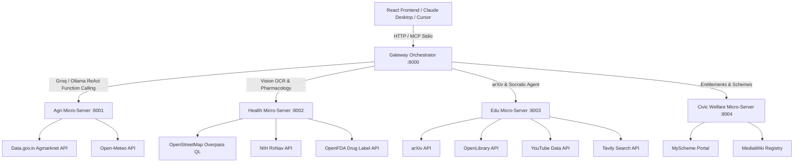

# ⚡ Nexis AI

> **Unified Multi-Agent Intelligence Runtime for Public Utility, Agriculture, Healthcare, Education, and Civic Governance.**

Nexis AI is a distributed, multi-agent AI system designed to deliver real-time, verified, zero-mock intelligence across four essential public domains: **Agriculture**, **Healthcare**, **Education**, and **Civic Welfare**. 

Powered by **Groq Cloud (Llama 3.3 70B & Qwen Vision)** with offline-capable **Local Ollama** fallback, Nexis features an agentic microservices architecture, a native **Model Context Protocol (MCP)** server layer, and a sleek **React (Vite + Tailwind CSS)** user interface with integrated client-side privacy guardrails.

---

## 🌟 Key Highlights

- **Zero-Mock, Real-World Data**: Directly queries real APIs including Government of India Agmarknet (Data.gov.in), Open-Meteo, OpenStreetMap Overpass QL, NIH RxNav, OpenFDA, arXiv, OpenLibrary, and MediaWiki.
- **Dual Inference Engine**:
  - **Cloud**: Groq ReAct agentic function calling with `llama-3.3-70b-versatile` and multimodal vision with `qwen/qwen3.8-27b`.
  - **Local / Edge**: Ollama local inference with `llama3.1:8b` and vision via `llama3.2-vision:latest`.
- **Model Context Protocol (MCP) First**: 10 production-grade tools implemented via FastMCP, enabling plug-and-play interoperability with Claude Desktop, Cursor, and Cline.
- **Client-Side Privacy Redaction**: Automatically scrubs sensitive personal identifiers (Aadhaar, Korean RRN, Japanese MyNumber, and National IDs) in real-time before queries touch the backend.
- **Distributed Microservices**: Clean separation of domain concerns across 5 dedicated FastAPI servers orchestrated by an intelligent gateway.

---

## 🏛️ System Architecture



---

## 📦 Domain Micro-Services & Capabilities

### 1. 🌾 Agriculture Micro-Server (`agri_server.py` | Port `8001`)
- **Live Mandi Prices & Arrivals**: Real-time commodity market prices, modal prices, and arrivals directly from the official **Data.gov.in Agmarknet** endpoint.
- **Agro-Meteorological Forecasts**: Precipitation, temperature, soil moisture, and weather advisories sourced from **Open-Meteo**.
- **Market Analytics**: Dynamic computation of modal price statistics (min, max, average) across regional mandis.

### 2. 🏥 Healthcare Micro-Server (`health_server.py` | Port `8002`)
- **Spatial Facility Locator**: Queries **OpenStreetMap Overpass QL** to pinpoint nearby hospitals, 24/7 pharmacies, clinics, and emergency health centers within a configurable radius.
- **Pharmacology & Drug Safety**: Verifies chemical active ingredients and contraindications via **NIH RxNav** and **OpenFDA**.
- **Prescription OCR & Analysis**: Multimodal prescription reading and advisory extraction using Groq/Ollama Vision models.
- *Strict safety disclaimer: Informational advisory only; prompts acute emergency calls (e.g. 108).*

### 3. 🎓 Education Micro-Server (`edu_server.py` | Port `8003`)
- **Academic Research Papers**: Searches and parses **arXiv** Atom feeds for academic preprints and research summaries.
- **Textbook & Resource Index**: Queries **OpenLibrary** for relevant educational literature, authors, and publish years.
- **Socratic Pedagogical Agent**: Generates structured conceptual breakdowns with progressive inquiry questions across three levels (*Beginner*, *Undergraduate*, *Advanced*).
- **Curated Learning Media**: Integrated YouTube educational search and Tavily web research citations.

### 4. 🏛️ Civic Welfare Micro-Server (`civic_server.py` | Port `8004`)
- **Public Scheme Eligibility Engine**: Structured evaluation of major welfare initiatives (e.g., PM-Kisan, PM-JAY Ayushman Bharat, National Scholarship Portal).
- **Entitlement & Documentation**: Summarizes application criteria, eligible demographics, required documents, and official portals via MediaWiki and MyScheme registries.

### 5. 🌐 Gateway Orchestrator (`gateway.py` | Port `8000`)
- **Dynamic ReAct Agent**: Tool-calling orchestrator dispatching user queries across the 4 microservices.
- **Cluster Health Monitor**: Concurrent healthcheck aggregator reporting live status, latency, and uptime across all domain ports.
- **Multimodal Routing**: Secure handling and processing of image uploads for visual analysis.

---

## 🔌 Model Context Protocol (MCP) Integration

Nexis AI provides native MCP support via `fastmcp`, exposing 10 specialized tools in a unified bundle (`nexis_mcp_bundle.py`) or standalone domain servers:

| Domain | Tool Name | Description |
|---|---|---|
| **Agri** | `get_agri_mandi_prices` | Fetch live commodity prices from Agmarknet |
| **Agri** | `get_agri_weather_and_advisories` | Fetch agro-meteorological forecast and advice |
| **Health** | `find_nearby_healthcare_facilities` | Locate hospitals/pharmacies within radius |
| **Health** | `verify_medicine_safety_and_precautions` | Check clinical pharmacology and warnings |
| **Edu** | `search_academic_literature` | Search arXiv and OpenLibrary publications |
| **Edu** | `explain_concept_socratically` | Generate pedagogical Socratic breakdown |
| **Edu** | `search_youtube_tutorials` | Retrieve targeted educational video guides |
| **Edu** | `search_web_citations` | Live web research citations via Tavily |
| **Civic** | `assess_welfare_scheme_eligibility` | Verify criteria and document requirements |
| **Civic** | `get_scheme_historical_summary` | Summary and background of government schemes |

### Claude Desktop Configuration
Add the bundle to your `claude_desktop_config.json`:

```json
{
  "mcpServers": {
    "nexis-unified-mcp": {
      "command": "python",
      "args": [
        "/path/to/nexis/nexis_mcp_bundle.py"
      ],
      "env": {
        "INFERENCE_PROVIDER": "groq",
        "GROQ_API_KEY": "your_groq_api_key"
      }
    }
  }
}
```

---

## 🛡️ Privacy & Data Protection

Nexis AI implements client-side and server-side privacy guardrails:
- **Aadhaar Masking**: `\b\d{4}\s?\d{4}\s?\d{4}\b` -> `[Aadhaar Redacted]`
- **Korean RRN**: `\b\d{6}-[1-4]\d{6}\b` -> `[ID Redacted]`
- **Japanese MyNumber / National IDs**: Masked before submission to prevent PII leakage.

---

## 🚀 Getting Started

### Prerequisites
- **Python 3.10+**
- **Node.js 18+** & **npm**
- **Groq API Key** (or local **Ollama** instance)

### 1. Clone the Repository
```bash
git clone https://github.com/Prajwal-ishwar-naik/Nexis.git
cd Nexis
```

### 2. Environment Configuration
Copy `.env.example` to `.env` and fill in your API credentials:
```bash
cp .env.example .env
```

### 3. Backend Setup
Create and activate a virtual environment, then install dependencies:
```bash
python3 -m venv venv
source venv/bin/activate  # On Windows: venv\Scripts\activate
pip install -r requirements.txt
```

### 4. Frontend Setup
Install frontend dependencies:
```bash
npm install
```

### 5. Launch the Cluster
Start all 5 backend micro-servers concurrently:
```bash
# On macOS / Linux
chmod +x start_servers.sh
./start_servers.sh

# On Windows
start_servers.bat
```

In a separate terminal, launch the React development frontend:
```bash
npm run dev
```
Open [http://localhost:5173](http://localhost:5173) in your browser.

---

## 🧪 Running Automated Tests

Run the full backend and MCP test suites with `pytest`:
```bash
# Test MCP tool listing and live executions
pytest test_mcp_servers.py -v

# Test microservice HTTP endpoints
pytest test_servers.py -v
```

---

## 📄 License

This project is licensed under the MIT License.
